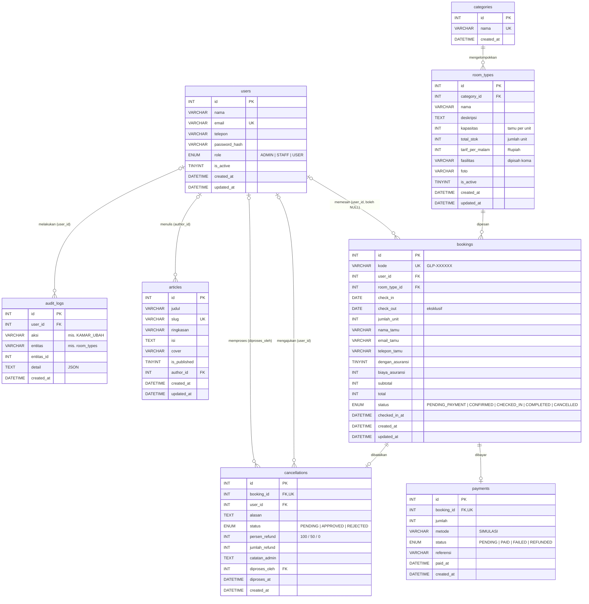

# ERD — Database Glampora

Sumber kebenaran skema: `database/glampora.sql`. Diagram di bawah ditampilkan otomatis oleh GitHub. Untuk versi draw.io: buka draw.io → **Arrange → Insert → Advanced → Mermaid**, tempel isi blok `mermaid` di bawah, lalu rapikan.

## Penjelasan tabel

| Tabel | Isi | Catatan desain |
|---|---|---|
| `users` | Semua akun: admin, staff, user | Password disimpan sebagai hash (`password_hash`). Akun tidak dihapus, cukup `is_active = 0`. |
| `categories` | Kategori kamar (Tenda Safari, Dome, Cabin) | Nama unik. Tidak bisa dihapus selama masih dipakai kamar. |
| `room_types` | Jenis kamar beserta stok dan tarif | Stok = jumlah unit fisik; sisa per tanggal dihitung dari `bookings`. Kamar yang pernah dipesan hanya dinonaktifkan agar riwayat tetap utuh. |
| `bookings` | Reservasi | `check_out` eksklusif (10→12 = 2 malam). `user_id` boleh NULL untuk tamu tanpa login. Indeks `idx_booking_stok` mempercepat cek ketersediaan. |
| `payments` | Pembayaran simulasi, 1 per booking | `ON DELETE CASCADE` ikut terhapus bersama booking. |
| `cancellations` | Pengajuan pembatalan, 1 per booking | Menyimpan persen & jumlah refund serta staff yang memproses. |
| `articles` | Artikel/blog | `slug` unik dibuat dari judul (duplikat diberi akhiran `-2`, `-3`, ...). |
| `audit_logs` | Catatan setiap aksi staff/admin | `detail` berisi JSON (mis. nilai lama → baru). Diisi lewat `catat_aksi()`. |

Semua tabel memakai `ENGINE=InnoDB` (wajib untuk foreign key dan transaksi di fitur booking) dan `utf8mb4`.
