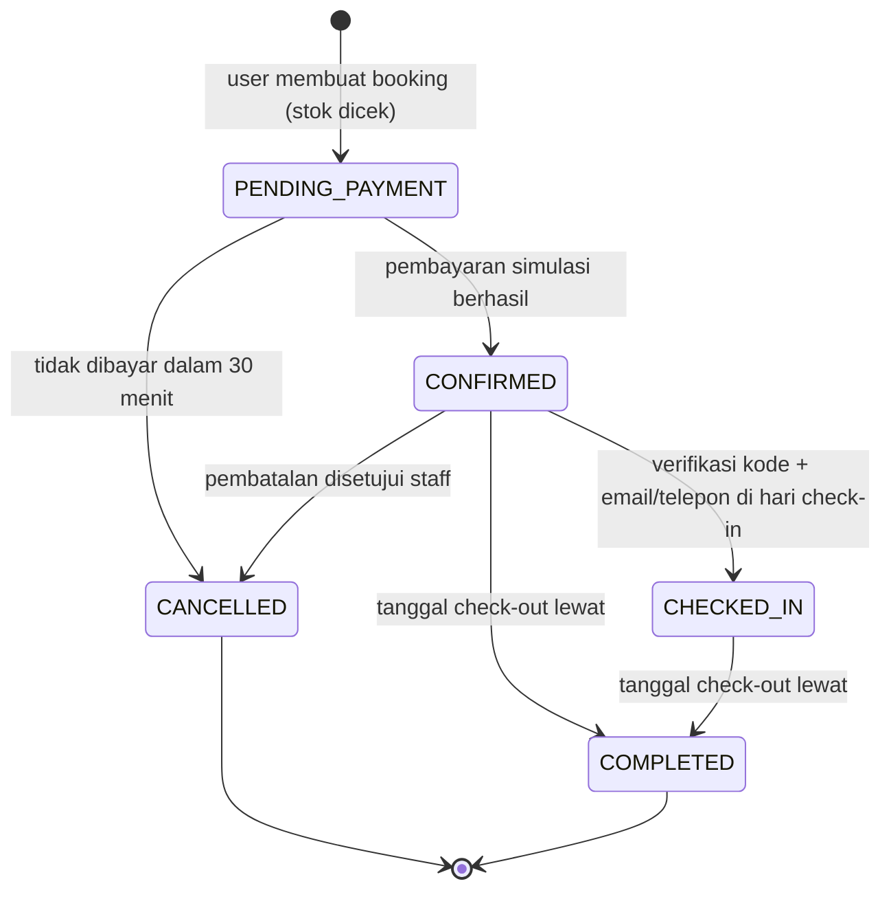
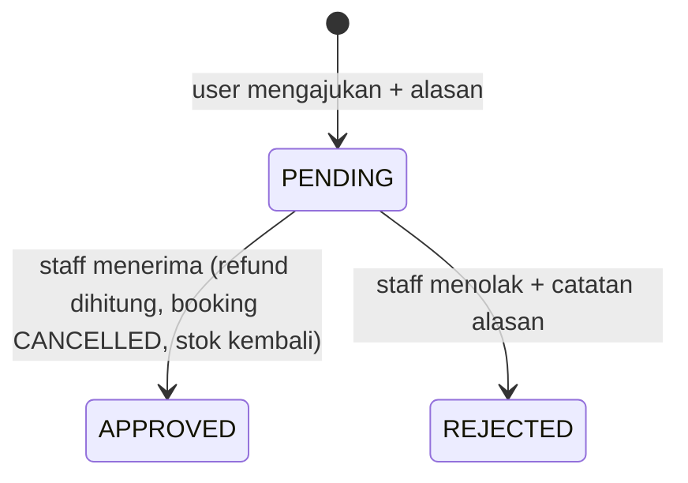

# Proses Bisnis Reservasi & Pembatalan

Penanggung jawab: Backend 2 (disepakati bersama tim di Minggu 1).

## Keputusan kelompok

| Aturan                                                     | Nilai                                                                 | Lokasi di kode                                   |
| ---------------------------------------------------------- | --------------------------------------------------------------------- | ------------------------------------------------ |
| Biaya asuransi                                             | 10% dari harga kamar (subtotal)                                       | `PERSEN_ASURANSI` di `includes/booking.php`      |
| Refund dengan asuransi, diajukan > 3 hari sebelum check-in | 100% harga kamar                                                      | `includes/refund.php`                            |
| Refund dengan asuransi, diajukan ≤ 3 hari sebelum check-in | 50% harga kamar                                                       | `includes/refund.php`                            |
| Refund tanpa asuransi                                      | 0%                                                                    | `REFUND_TANPA_ASURANSI` di `includes/refund.php` |
| Biaya asuransi ikut dikembalikan?                          | Tidak                                                                 | `includes/refund.php`                            |
| Patokan "H-berapa"                                         | Tanggal pengajuan pembatalan (bukan tanggal staff memproses)          | `hitung_refund()`                                |
| Batas waktu bayar                                          | 30 menit, lewat dari itu booking dibatalkan otomatis                  | `BATAS_BAYAR_MENIT` di `includes/booking.php`    |
| Lama menginap maksimal                                     | 14 malam                                                              | `MAKS_MALAM`                                     |
| Pembatalan boleh diajukan                                  | Hanya booking yang sudah dibayar, sebelum tanggal check-in, satu kali | `api/cancellations.php`                          |
| Booking yang mengurangi stok                               | `PENDING_PAYMENT` (< 30 menit), `CONFIRMED`, `CHECKED_IN`             | `hitung_sisa_unit()`                             |

## Status booking

## Status pengajuan pembatalan

## Rumus penting

- **Jumlah malam** = selisih hari check-in sampai check-out (check-out tidak dihitung).
- **Dua rentang bentrok** jika `A.check_in < B.check_out` dan `A.check_out > B.check_in`.
  Check-out tamu A di hari yang sama dengan check-in tamu B tidak bentrok.
- **Sisa unit** = total stok − pemakaian terbanyak pada salah satu malam di rentang yang diminta.
- **Total bayar** = tarif per malam × jumlah malam × jumlah unit, + 10% jika memakai asuransi.
